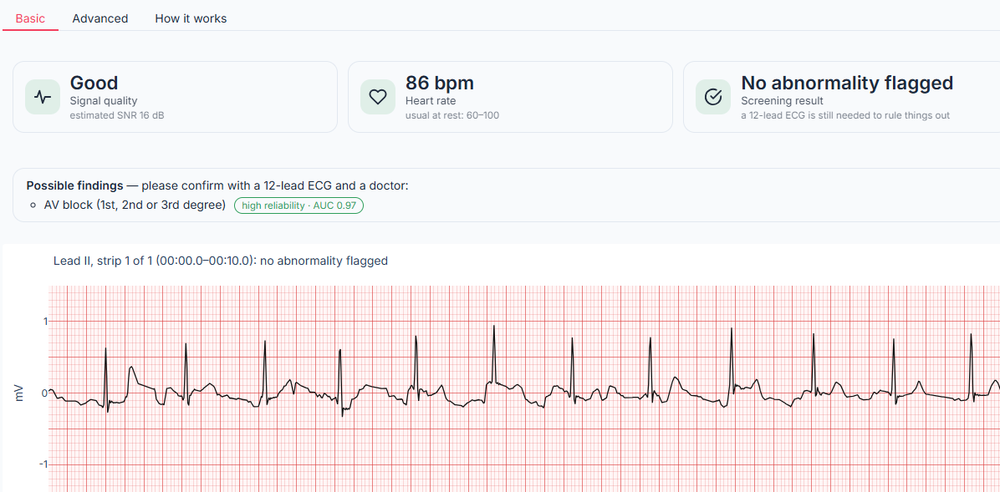
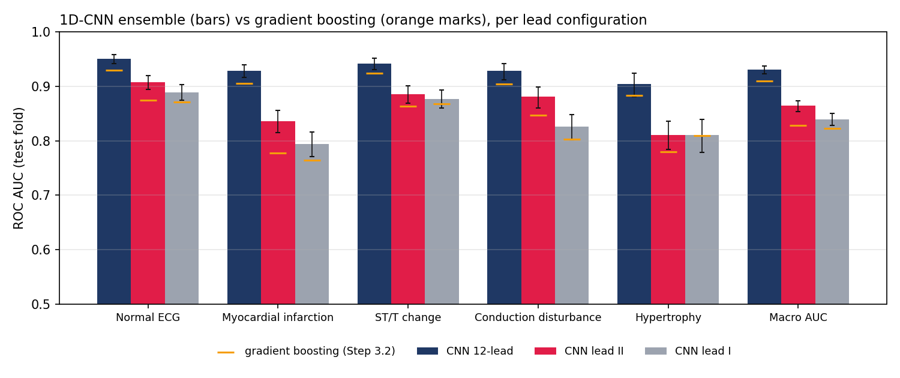
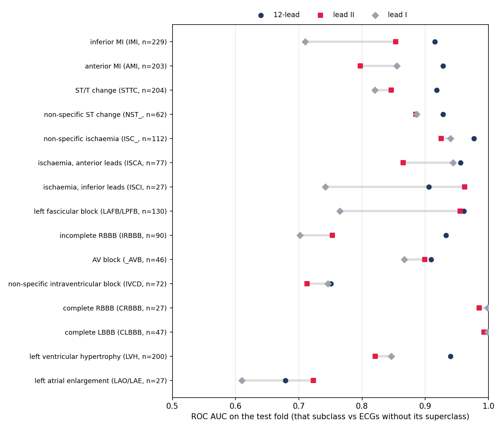
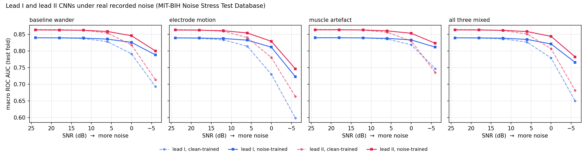
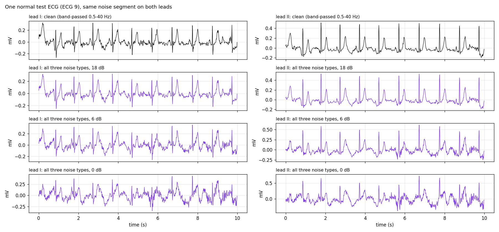
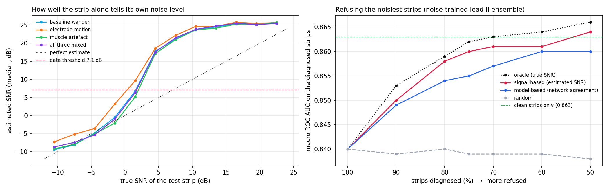
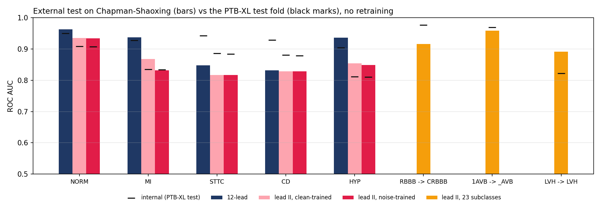

# ECG Lead II Diagnosis

How much of a 12-lead ECG diagnosis survives in **one lead**, and does it survive **real recorded noise**? This
project answers that for lead II, the lead a low-cost 3-electrode board such as the AD8232 can record, using the
PTB-XL database (21,799 ECGs from 18,869 patients), real ambulatory noise from the MIT-BIH Noise Stress Test
Database, a signal-quality gate that refuses strips it cannot read, and an external test on a second country's
hospital (Chapman-Shaoxing, China). It is the third part of a single-lead ECG analyzer, after beat classification
([Project 1](https://github.com/fady-mostafa-omar/ecg-arrhythmia-detector)) and atrial fibrillation detection ([Project 2](https://github.com/fady-mostafa-omar/ecg-af-detector)).

| Basic: for anyone | Advanced: for clinicians and researchers |
|---|---|
|  |  |

## Results at a glance

- **One lead keeps most of it.** On the locked PTB-XL test fold, macro AUC is 0.931 with 12 leads, **0.864
  with lead II** and 0.839 with lead I (5 diagnostic groups; 5-network ensembles). Lead II minus 12 leads:
  -0.066 (-0.074 to -0.059); the largest losses are myocardial infarction (-0.093) and
  hypertrophy (-0.093).
- **Lead II and lead I see different things.** Lead II minus lead I is +0.025 (+0.014 to +0.035) overall, but this small
  average hides large opposite effects: lead II is better for ischaemia, inferior leads (+0.217), left fascicular block (+0.191), inferior MI (+0.142), left atrial enlargement (+0.114); lead I is better for anterior MI (-0.059), ischaemia, anterior leads (-0.078), complete RBBB (-0.014), complete LBBB (-0.006).
- **Naming the diagnosis from lead II.** A lead II network trained on the 23 PTB-XL subclasses reaches AUC complete LBBB 0.989, complete RBBB 0.977, AV block 0.969, left fascicular block 0.955, ischaemia, inferior leads 0.909, and tells
  inferior from anterior infarction with AUC 0.863.
- **Noise:** with the three noise types mixed, the lead II model trained on clean ECGs scores
  0.864 without noise, 0.806 at 0 dB and 0.681 at -6 dB.
  Training with real noise (from a separate part of each noise recording) gives 0.844 and
  0.782, with no measurable cost on clean ECGs (-0.001 (-0.004 to +0.001)).
- **Quality gate:** judging each 10-s strip from the strip alone, it refuses
  94% of the strips below 0 dB and
  6% of the others; on the accepted strips the noise-trained model scores
  0.861 (close to the 0.863 on clean ECGs). On real clinical ECGs from another hospital it
  refused 2.1%.
- **Another country:** on Chapman-Shaoxing (a fixed random 10,000 of the 45,053 usable ECGs, pre-specified label mapping), without retraining, the mean AUC over the five groups is
  12-lead: 0.903 (PTB-XL 0.931), lead II, clean-trained: 0.860 (PTB-XL 0.864), lead II, noise-trained: 0.852 (PTB-XL 0.863).

## The app

Pick a bundled example or upload a lead II ECG (CSV in millivolts, any sampling rate of at least 100 Hz, 10 s to
10 min). The recording is cut into 10-s strips. Each strip first passes the quality gate; readable strips are then
screened for the five groups and for the named findings lead II detects reliably.

- **Basic:** signal quality, heart rate, screening result, the named findings with their reliability, the strip on
  ECG paper, a strip-by-strip timeline for longer recordings, and the cardiologists' label for the examples.
- **Advanced:** the probability of each group next to its decision threshold, all 23 named findings with their
  test-fold AUC, the estimated SNR and the disagreement between networks, and a table of all strips (CSV).
- **How it works:** the main result tables, filled from `results/`.

Bundled examples (13): random PTB-XL test-fold ECGs (never used for training) with one cardiologist label
each, the normal one with real test-part noise added at 12, 0 and -6 dB, and a 60-s montage of six test ECGs.

There is **no automatic inversion**: lead II polarity carries diagnostic information (in left anterior fascicular
block the QRS in lead II is mostly negative). Research and education tool, not a medical device.

## Data

| Dataset | Use | Size |
|---|---|---|
| [PTB-XL 1.0.3](https://physionet.org/content/ptb-xl/1.0.3/) (Germany) | training, validation, internal test | 21,799 10-s 12-lead ECGs, 18,869 patients |
| [MIT-BIH Noise Stress Test Database](https://physionet.org/content/nstdb/1.0.0/) | real noise: baseline wander, electrode motion, muscle | 3 × 30 min, 2 channels |
| [Chapman-Shaoxing / Ningbo](https://physionet.org/content/ecg-arrhythmia/1.0.0/) (China) | external test only | 45,053 usable 10-s 12-lead ECGs |

PTB-XL task: the 5 diagnostic superclasses of the PTB-XL benchmark, aggregated from the SCP statements;
21,388 ECGs have at least one (the others have no diagnostic statement and are left out). Official patient-wise
folds: 1-8 training (17,084), 9 validation (2,146), 10 test
(2,158); no patient is in more than one fold. The test fold was scored once per model.

| Part | Normal ECG | Myocardial infarction | ST/T change | Conduction disturbance | Hypertrophy | ECGs |
| --- | --- | --- | --- | --- | --- | --- |
| train | 7,596 | 4,379 | 4,186 | 3,907 | 2,119 | 17,084 |
| val | 955 | 540 | 528 | 495 | 268 | 2,146 |
| test | 963 | 550 | 521 | 496 | 262 | 2,158 |
| total | 9,514 | 5,469 | 5,235 | 4,898 | 2,649 | 21,388 |

## Methods

- **Signals:** the 100 Hz PTB-XL records, band-pass 0.5-40 Hz, kept in millivolts with one global scale per lead
  (from the training fold), so voltage information (hypertrophy) is not normalized away. Lead II and lead I are taken
  from the 12-lead record.
- **Baseline:** median beat and 8 morphology features per lead plus 7 rhythm features (R peaks with the detector of
  Project 1), one gradient-boosting classifier per group.
- **CNN:** residual 1D-CNN (1.9 million parameters), AdamW, one-cycle schedule, 30 epochs, augmentation with
  amplitude scaling, shifts and light Gaussian noise. The epoch is chosen on the validation fold.
  5 networks with different seeds are averaged; averaging was fixed in advance, not chosen on the test fold.
- **Noise:** MIT-BIH Noise Stress Test Database (bw, em, ma), both channels, resampled 360 -> 100 Hz; first 60% of each record for training and validation, last 40% for the
  test, with a 10-s gap. SNR = 10*log10(P_ecg / P_noise), both on the 0.5-40 Hz band-passed 10-s strip. The noise-trained models see noise on
  50% of the training strips at 0 to
  24 dB; the test uses 24, 18, 12, 6, 0, -6 dB, with the same noise
  segments for every model and lead.
- **Quality gate:** seven features of the strip (amplitude distribution, where the power sits in the spectrum,
  periodicity, amplitude) and a gradient-boosting regressor that estimates the SNR in dB, trained on the training fold
  with training-part noise. A strip is diagnosed only if its estimated SNR is at least 7.1 dB;
  the threshold maximizes sensitivity + specificity for "true SNR below 0 dB" on the validation fold.
- **Decisions:** one threshold per group and per named finding, chosen on the validation fold the same way.
- **Statistics:** ROC AUC per group and macro AUC; 95% intervals and paired differences from 1,000 patient-level
  bootstrap resamples (all ECGs of a patient together). A difference is called real only when its interval excludes 0.

## Results

### 1. One lead versus twelve (PTB-XL test fold)

| Input | Model | NORM | MI | STTC | CD | HYP | Macro AUC (95% CI) |
| --- | --- | --- | --- | --- | --- | --- | --- |
| **12-lead** | CNN, 5-seed ensemble | 0.950 | 0.928 | 0.942 | 0.929 | 0.904 | **0.931** (0.923–0.937) |
|  | CNN, one network (mean ± SD) |  |  |  |  |  | 0.921 ± 0.002 |
|  | Gradient boosting on beat features | 0.929 | 0.905 | 0.924 | 0.904 | 0.884 | 0.909 |
| **lead II** | CNN, 5-seed ensemble | 0.908 | 0.835 | 0.886 | 0.881 | 0.811 | **0.864** (0.854–0.874) |
|  | CNN, one network (mean ± SD) |  |  |  |  |  | 0.858 ± 0.002 |
|  | Gradient boosting on beat features | 0.875 | 0.777 | 0.863 | 0.846 | 0.780 | 0.828 |
| **lead I** | CNN, 5-seed ensemble | 0.889 | 0.794 | 0.877 | 0.826 | 0.810 | **0.839** (0.828–0.850) |
|  | CNN, one network (mean ± SD) |  |  |  |  |  | 0.835 ± 0.001 |
|  | Gradient boosting on beat features | 0.872 | 0.764 | 0.868 | 0.803 | 0.809 | 0.823 |

| Paired difference | NORM | MI | STTC | CD | HYP | Macro |
| --- | --- | --- | --- | --- | --- | --- |
| lead II minus 12-lead | -0.043 (-0.052 to -0.034) | -0.093 (-0.109 to -0.077) | -0.056 (-0.069 to -0.043) | -0.047 (-0.061 to -0.033) | -0.093 (-0.116 to -0.070) | -0.066 (-0.074 to -0.059) |
| lead II minus lead I | +0.019 (+0.007 to +0.031) | +0.041 (+0.015 to +0.066) | +0.009 (-0.010 to +0.026) | +0.055 (+0.031 to +0.076) | +0.001 (-0.029 to +0.032) | +0.025 (+0.014 to +0.035) |
| lead II: CNN minus gradient boosting | +0.033 (+0.024 to +0.041) | +0.058 (+0.043 to +0.074) | +0.022 (+0.012 to +0.033) | +0.035 (+0.022 to +0.049) | +0.032 (+0.010 to +0.055) | +0.036 (+0.028 to +0.043) |

### 2. Which diagnoses survive in lead II, and which in lead I

Three hypotheses were written down before looking, from ECG physiology:
- H1: inferior infarction is detected better from lead II than from lead I. **confirmed**:
  0.853 vs 0.710, difference +0.142 (+0.107 to +0.182).
- H2: anterior infarction is detected poorly from both single leads. **partly**: lead II 0.797 and lead I 0.855 vs 12 leads 0.928; lead II minus lead I -0.059 (-0.088 to -0.031).
- H3: AV block is detected better from lead II. **not supported (no clear difference)**: 0.899 vs 0.867,
  difference +0.033 (-0.015 to +0.078).

Per subclass (positives: ECGs whose only subclass within that group is this one; negatives: ECGs without the group;
score: the group output). Bold differences exclude 0; with this many comparisons one or two may do so by chance, and
everything beyond H1-H3 is exploratory.

| Subclass | ECGs | 12-lead | lead II | lead I | lead II minus lead I (95% CI) |
| --- | --- | --- | --- | --- | --- |
| inferior MI (IMI) | 229 | 0.915 | 0.853 | 0.710 | **+0.142 (+0.107 to +0.182)** |
| anterior MI (AMI) | 203 | 0.928 | 0.797 | 0.855 | **-0.059 (-0.088 to -0.031)** |
| ST/T change (STTC) | 204 | 0.918 | 0.846 | 0.820 | +0.026 (-0.005 to +0.058) |
| non-specific ST change (NST_) | 62 | 0.928 | 0.885 | 0.886 | -0.001 (-0.048 to +0.046) |
| non-specific ischaemia (ISC_) | 112 | 0.977 | 0.925 | 0.940 | -0.015 (-0.039 to +0.011) |
| ischaemia, anterior leads (ISCA) | 77 | 0.956 | 0.865 | 0.944 | **-0.078 (-0.114 to -0.046)** |
| ischaemia, inferior leads (ISCI) | 27 | 0.906 | 0.962 | 0.742 | **+0.217 (+0.140 to +0.300)** |
| left fascicular block (LAFB/LPFB) | 130 | 0.961 | 0.955 | 0.765 | **+0.191 (+0.142 to +0.244)** |
| incomplete RBBB (IRBBB) | 90 | 0.933 | 0.753 | 0.702 | +0.052 (-0.003 to +0.107) |
| AV block (_AVB) | 46 | 0.909 | 0.899 | 0.867 | +0.033 (-0.015 to +0.078) |
| non-specific intraventricular block (IVCD) | 72 | 0.751 | 0.713 | 0.746 | -0.033 (-0.102 to +0.035) |
| complete RBBB (CRBBB) | 27 | 0.999 | 0.985 | 0.999 | **-0.014 (-0.025 to -0.007)** |
| complete LBBB (CLBBB) | 47 | 0.999 | 0.993 | 0.999 | **-0.006 (-0.013 to -0.001)** |
| left ventricular hypertrophy (LVH) | 200 | 0.940 | 0.821 | 0.846 | -0.025 (-0.060 to +0.011) |
| left atrial enlargement (LAO/LAE) | 27 | 0.679 | 0.723 | 0.610 | **+0.114 (+0.036 to +0.185)** |

### 3. Naming the diagnosis from lead II

One-vs-rest AUC of the 23-subclass lead II network on the test fold (subclasses with at least 20 test ECGs), and the
sensitivity, specificity and positive predictive value at the threshold chosen on the validation fold. PPV is low for
rare findings: a flag means "get a 12-lead ECG", not a diagnosis.

| Finding | Test ECGs | AUC (95% CI) | Sensitivity | Specificity | PPV |
| --- | --- | --- | --- | --- | --- |
| complete LBBB | 54 | 0.989 (0.978–0.996) | 94% | 94% | 30% |
| complete RBBB | 54 | 0.977 (0.965–0.987) | 94% | 90% | 19% |
| AV block | 82 | 0.969 (0.957–0.980) | 96% | 88% | 24% |
| left fascicular block | 179 | 0.955 (0.932–0.975) | 88% | 94% | 58% |
| ischaemia, inferior leads | 40 | 0.909 (0.865–0.942) | 82% | 84% | 9% |
| normal ECG | 963 | 0.905 (0.893–0.917) | 86% | 80% | 77% |
| non-specific ischaemia | 128 | 0.898 (0.873–0.920) | 88% | 77% | 20% |
| inferior MI | 327 | 0.878 (0.857–0.899) | 78% | 81% | 42% |
| left atrial enlargement | 42 | 0.845 (0.792–0.895) | 79% | 72% | 5% |
| ST/T change | 222 | 0.840 (0.815–0.866) | 80% | 70% | 23% |
| ischaemia, anterior leads | 93 | 0.833 (0.793–0.871) | 75% | 78% | 13% |
| non-specific ST change | 77 | 0.831 (0.796–0.863) | 83% | 72% | 10% |
| left ventricular hypertrophy | 214 | 0.822 (0.793–0.852) | 78% | 72% | 24% |
| anterior MI | 306 | 0.806 (0.780–0.832) | 76% | 69% | 29% |
| incomplete RBBB | 112 | 0.801 (0.761–0.836) | 70% | 74% | 13% |
| non-specific intraventricular block | 79 | 0.737 (0.672–0.796) | 56% | 78% | 9% |
| lateral MI | 20 | 0.672 (0.534–0.799) | 70% | 53% | 1% |

Among infarctions labelled only inferior or only anterior, the network tells which with AUC 0.863.

Five groups (noise-trained lead II ensemble, thresholds from the validation fold):

| Group | Threshold | Sensitivity | Specificity | PPV | Test positives |
| --- | --- | --- | --- | --- | --- |
| Normal ECG | 53.3% | 86% | 81% | 78% | 963 |
| Myocardial infarction | 21.2% | 75% | 75% | 50% | 550 |
| ST/T change | 19.7% | 84% | 76% | 53% | 521 |
| Conduction disturbance | 16.4% | 78% | 84% | 59% | 496 |
| Hypertrophy | 11.5% | 78% | 69% | 26% | 262 |

### 4. Real recorded noise

Macro AUC on the test fold, the three noise types mixed at equal power (lower SNR = more noise):

| Lead | Model | No noise | 24 dB | 18 dB | 12 dB | 6 dB | 0 dB | -6 dB |
| --- | --- | --- | --- | --- | --- | --- | --- | --- |
| lead I | clean-trained | 0.839 | 0.839 | 0.838 | 0.836 | 0.826 | 0.778 | 0.650 |
| lead I | noise-trained | 0.839 | 0.839 | 0.839 | 0.838 | 0.834 | 0.821 | 0.765 |
| lead II | clean-trained | 0.864 | 0.864 | 0.863 | 0.861 | 0.851 | 0.806 | 0.681 |
| lead II | noise-trained | 0.863 | 0.863 | 0.863 | 0.862 | 0.858 | 0.844 | 0.782 |

Lead II by noise type (electrode motion hurts most):

| Noise type (lead II) | Clean-trained, 0 dB | Noise-trained, 0 dB | Clean-trained, -6 dB | Noise-trained, -6 dB |
| --- | --- | --- | --- | --- |
| baseline wander | 0.818 | 0.845 | 0.713 | 0.800 |
| electrode motion | 0.780 | 0.829 | 0.663 | 0.746 |
| muscle artefact | 0.830 | 0.853 | 0.735 | 0.823 |
| all three mixed | 0.806 | 0.844 | 0.681 | 0.782 |

- Noise-trained minus clean-trained, lead II: -0.001 (-0.004 to +0.001) without noise, +0.037 (+0.031 to +0.043) at 0 dB,
  +0.101 (+0.091 to +0.111) at -6 dB (the training range stopped at 0 dB). Lead I:
  -0.000 (-0.002 to +0.002), +0.042 (+0.036 to +0.048), +0.116 (+0.104 to +0.127).
- Lead II minus lead I, both noise-trained, same noise: +0.024 (+0.012 to +0.034) without noise,
  +0.023 (+0.010 to +0.035) at 0 dB, +0.017 (+0.001 to +0.032) at -6 dB. Lead II stays the better single lead under noise. Which
  electrode placement picks up less noise in real life is a separate question that only real recordings can answer.

### 5. Quality gate

Test strips: each test ECG clean plus three copies with test-part noise at a random SNR from -12 to 24 dB.

| True noise level of the strip | Signal-based gate refuses | Model-based gate refuses |
| --- | --- | --- |
| clean | 0% | 24% |
| +12 to +24 dB | 0% | 25% |
| +6 to +12 dB | 3% | 26% |
| +0 to +6 dB | 32% | 31% |
| -6 to +0 dB | 91% | 59% |
| -12 to -6 dB | 98% | 91% |
| Sensitivity (strips below 0 dB refused) | 94% | 74% |
| False refusals (strips at 0 dB or better) | 6% | 26% |
| Strips diagnosed (coverage) | 71% | 62% |

The model-based gate (disagreement between the networks) refuses 24% of clean strips: uncertainty about the diagnosis is not the same as a bad signal, so the app uses the signal-based gate. Macro AUC with the signal-based gate:
noise-trained model 0.840 on all strips, 0.861 on accepted ones
(+0.021 (+0.018 to +0.024)), 0.782 on refused ones; clean-trained model 0.813 → 0.855.

Diagnosing only the best X% of strips:

| Gate | 100% | 90% | 80% | 75% | 70% | 60% | 50% |
| --- | --- | --- | --- | --- | --- | --- | --- |
| oracle (true SNR) | 0.840 | 0.853 | 0.859 | 0.862 | 0.863 | 0.864 | 0.866 |
| signal-based (estimated SNR) | 0.840 | 0.850 | 0.858 | 0.860 | 0.861 | 0.861 | 0.864 |
| model-based (network agreement) | 0.840 | 0.849 | 0.854 | 0.855 | 0.857 | 0.860 | 0.860 |
| random | 0.840 | 0.839 | 0.840 | 0.839 | 0.839 | 0.839 | 0.838 |

### 6. External test: another country's hospital

Chapman-Shaoxing (a fixed random 10,000 of the 45,053 usable ECGs, pre-specified label mapping), no retraining, the same preprocessing and the PTB-XL scales. Only findings with a clear
match to PTB-XL were tested, fixed before any result was seen (see the top of `scripts/06_external_chapman.py`).

| Task | Model | Chapman positives | AUC Chapman (95% CI) | AUC PTB-XL test | Difference |
| --- | --- | --- | --- | --- | --- |
| NORM | 12-lead | 1,326 | 0.963 (0.958–0.968) | 0.950 | +0.013 |
| NORM | lead II, clean-trained | 1,326 | 0.935 (0.928–0.942) | 0.908 | +0.027 |
| NORM | lead II, noise-trained | 1,326 | 0.934 (0.927–0.940) | 0.907 | +0.027 |
| MI | 12-lead | 23 | 0.937 (0.881–0.983) | 0.928 | +0.009 |
| MI | lead II, clean-trained | 23 | 0.868 (0.760–0.945) | 0.835 | +0.033 |
| MI | lead II, noise-trained | 23 | 0.832 (0.718–0.926) | 0.834 | -0.002 |
| STTC | 12-lead | 2,071 | 0.848 (0.840–0.856) | 0.942 | -0.094 |
| STTC | lead II, clean-trained | 2,071 | 0.817 (0.808–0.826) | 0.886 | -0.069 |
| STTC | lead II, noise-trained | 2,071 | 0.817 (0.808–0.826) | 0.884 | -0.067 |
| CD | 12-lead | 680 | 0.832 (0.818–0.845) | 0.929 | -0.097 |
| CD | lead II, clean-trained | 680 | 0.828 (0.816–0.841) | 0.881 | -0.053 |
| CD | lead II, noise-trained | 680 | 0.828 (0.816–0.841) | 0.879 | -0.051 |
| HYP | 12-lead | 177 | 0.936 (0.920–0.952) | 0.904 | +0.032 |
| HYP | lead II, clean-trained | 177 | 0.854 (0.825–0.880) | 0.811 | +0.043 |
| HYP | lead II, noise-trained | 177 | 0.849 (0.818–0.876) | 0.810 | +0.039 |
| RBBB -> CRBBB | lead II, 23 subclasses | 151 | 0.916 (0.895–0.936) | 0.977 | -0.061 |
| 1AVB -> _AVB | lead II, 23 subclasses | 269 | 0.958 (0.949–0.965) | 0.969 | -0.011 |
| LVH -> LVH | lead II, 23 subclasses | 147 | 0.891 (0.864–0.917) | 0.822 | +0.069 |

The label systems differ (Chapman uses SNOMED-CT codes, PTB-XL its own statements), so these numbers are approximate;
The stricter definition of "normal" in Chapman (sinus rhythm and no other code) likely explains part of why NORM scores higher there than on PTB-XL. The code inventory (`results/chapman_code_inventory.csv`) found 43 of the 94 codes used in the headers missing from the dataset's own code table, among them complete RBBB (1,092), left ventricular high voltage (5,382), ST changes (4,225), pacing rhythm (1,177), left anterior fascicular block (380). Their meaning was taken from the PhysioNet/CinC Challenge 2021 SNOMED-CT mapping.
Infarction has only 23 positives here, too few for a reliable AUC. The full test with a mapping consistent with PTB-XL's own definitions (`scripts/06c_external_chapman_full.py`, about 10 min on a GPU) is the first item of future work.

### 7. Design question: one channel or two?

Not chosen in advance, so all configurations are reported (3-network ensembles; references use seeds 0-2 of Section 1).
Gain over lead II alone: I + II +0.035 (+0.028 to +0.042), II + V1 +0.031 (+0.025 to +0.038), II + V2 +0.028 (+0.022 to +0.034), II + V5 +0.028 (+0.022 to +0.035).

| Input | Channels | NORM | MI | STTC | CD | HYP | Macro AUC | One network (mean ± SD) |
| --- | --- | --- | --- | --- | --- | --- | --- | --- |
| lead I | 1 | 0.889 | 0.794 | 0.874 | 0.825 | 0.809 | 0.838 | 0.835 ± 0.001 |
| lead II | 1 | 0.905 | 0.834 | 0.886 | 0.881 | 0.811 | 0.863 | 0.859 ± 0.001 |
| I + II | 2 | 0.929 | 0.883 | 0.923 | 0.894 | 0.862 | 0.898 | 0.893 ± 0.003 |
| II + V1 | 2 | 0.924 | 0.888 | 0.900 | 0.924 | 0.838 | 0.895 | 0.889 ± 0.002 |
| II + V2 | 2 | 0.921 | 0.902 | 0.905 | 0.912 | 0.819 | 0.892 | 0.885 ± 0.001 |
| II + V5 | 2 | 0.924 | 0.861 | 0.928 | 0.884 | 0.863 | 0.892 | 0.886 ± 0.001 |
| 12-lead | 12 | 0.950 | 0.927 | 0.941 | 0.926 | 0.901 | 0.929 | 0.921 ± 0.003 |

Lead I + lead II needs a two-channel front end (4 electrodes) and gives all six limb leads; a true chest lead needs the
Wilson central terminal (5 electrodes). This project targets **one** AD8232 (lead II); two channels are future work.

## Related work and what is new here

- Strodthoff et al. (IEEE JBHI 2021, [arXiv 2004.13701](https://arxiv.org/abs/2004.13701)): the PTB-XL benchmark, 12 leads,
  superclass macro AUC 0.921-0.930. One of our 12-lead networks scores 0.921 on the same test fold, in the same range, which checks the pipeline.
- Saglietto et al., [Front. Cardiovasc. Med. 2024](https://doi.org/10.3389/fcvm.2024.1327179): lead I alone against 12
  leads on PTB-XL (20 classes); lead II alone not tested.
- [Twelve to One](https://github.com/huh123-liang/twelve-to-one-ecg) (NTU course project, 2026): lead I and lead II
  alone on the five superclasses.
- Tiruwa and Ghimire, [medRxiv 2026](https://www.medrxiv.org/content/10.64898/2026.06.12.26355537v1): lead reduction
  and age.
- [noise-adapted-single-lead-hyp](https://github.com/gucci10248/noise-adapted-single-lead-hyp) (2026): lead I,
  hypertrophy only, synthetic noise augmentation, external validation.

What this repository adds (to our knowledge, from this search, not a systematic review): lead II and lead I compared
per subclass with physiology-based hypotheses; robustness to **real recorded** ambulatory noise with training and test
noise kept apart, for every group and both leads; a signal-quality gate evaluated by selective prediction; named
findings with validation-fold thresholds; and an external test, all in one open, reproducible pipeline.

## Limitations

- One lead cannot see everything: anterior and lateral infarction, incomplete RBBB and hypertrophy are detected much
  less well than with 12 leads. "No abnormality flagged" does not rule them out.
- The noise is real but added to clean hospital ECGs; ECGs recorded during movement are not identical, and the SNR is
  defined on the band-passed strip (not the NSTDB's QRS-based definition).
- The external label mapping is approximate (different label systems); see Section 6.
- Lead II is taken from 12-lead recordings at rest. No AD8232 or other low-cost recording has been tested yet.
- The two-channel comparison picked nothing in advance; it is reported as a design question, not a result.
- Research and education tool, not a medical device.

## Future work

1. External test on all Chapman-Shaoxing ECGs with the PTB-XL-consistent label mapping (`06c`, needs a GPU).
2. **Real AD8232 recordings on real patients**, worn together with a commercial Holter, with ethics approval.
3. Two channels (lead I + lead II, e.g. a two-channel front end such as the ADS1292R).
4. More training data (e.g. PTB-XL plus Chapman, then a third database for testing), a 12-lead teacher for the lead II
   network, and 500 Hz input.
5. Joining this project with Projects 1 and 2 into one single-lead analyzer with a Holter-style PDF report.

## Reproduce

| Script | What it does | Hardware (our runs) |
|---|---|---|
| `scripts/01_data.py` | download PTB-XL and the NSTDB, labels, split, compact copy | CPU |
| `scripts/02_baseline.py` | beat features + gradient boosting | CPU, ~25 min |
| `scripts/03_cnn.py` | CNN ensembles: 12-lead, lead II, lead I | GPU, ~27 min (T4) |
| `scripts/03b_subclasses.py` | Section 2 | CPU, ~2 min |
| `scripts/03c_lead_pairs_and_named_findings.py` | Sections 3 and 7 | GPU, ~28 min |
| `scripts/04_noise.py` | Section 4 | GPU, ~20 min |
| `scripts/05_quality_gate.py` | Section 5 | CPU ~30 min, GPU ~3 min |
| `scripts/06_external_chapman.py` | Section 6 (downloads 5 GB) | GPU recommended; on CPU it uses 10,000 ECGs (~70 min) |
| `scripts/06b_chapman_code_inventory.py` | every code in Chapman and its task | CPU, seconds |
| `scripts/06c_external_chapman_full.py` | all ECGs, both mappings | GPU, ~10 min |
| `scripts/07_app_assets.py` | thresholds and app examples | CPU, ~5 min |

Run them in order from the repository root (Linux or Colab; see the [notebook](https://colab.research.google.com/github/fady-mostafa-omar/ecg-lead2-diagnosis/blob/main/notebooks/ecg_lead2_diagnosis.ipynb)). The repository ships only
the models the app needs (`models/`); the others are re-created by the scripts. Unit tests: `pytest -q`
(also run by CI on every push).

## Repository

| Path | Content |
|---|---|
| `src/leadsuite/` | data access, R-peak detection, features, CNN, noise, quality gate, metrics |
| `scripts/` | one script per step, writing everything in `results/` |
| `app/` | the Gradio app and its examples |
| `models/` | lead II noise-trained ensemble, 23-subclass ensemble, quality gate, thresholds |
| `results/` | every table and figure quoted here |
| `tests/` | unit tests |
| `notebooks/` | Colab notebook: app and full reproduction |

## Data licenses and citation

PTB-XL (CC BY 4.0): Wagner P et al., Sci Data 7, 154 (2020). MIT-BIH Noise Stress Test Database: Moody GB, Muldrow WE,
Mark RG, Computers in Cardiology 11:381-384 (1984). Chapman-Shaoxing / Ningbo (CC BY 4.0): Zheng J et al., PhysioNet
(2022), doi:10.13026/wgex-er52. PhysioNet: Goldberger AL et al., Circulation 101(23):e215-e220 (2000).

Fady Mostafa Omar, 2026. MIT License.
